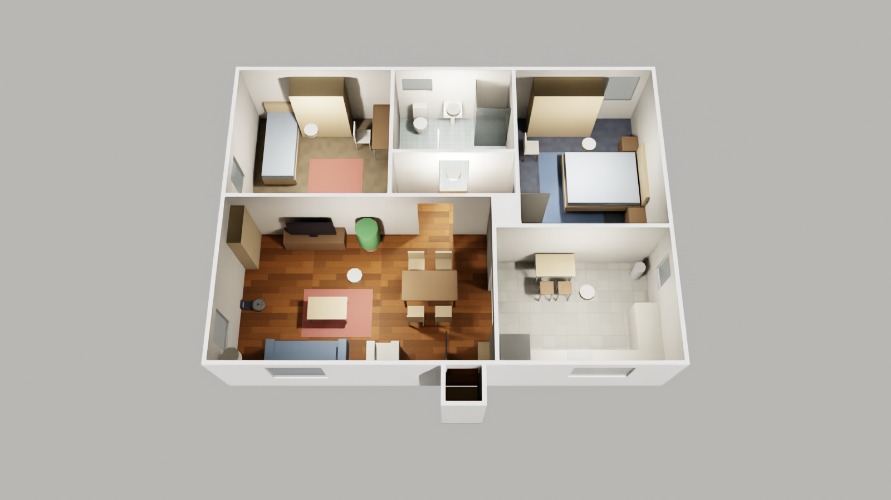

# MOTEbot simulator

The world that [MOTEbot](https://github.com/aravindsairam/motebot), a robot vacuum cleaner, lives in. Built with NVIDIA Isaac Sim 6.2 and connected to ROS 2 Humble.



## What is in it

- **Two homes.** A small two room house and a furnished six room home of 77.6 m².
- **The robot.** An iRobot Create 3 with a lidar, a colour and depth camera, an IMU, a bumper, cliff sensors and wheel odometry.
- **Real world flaws.** Every sensor has noise and the wheel odometry drifts, as on a real robot.
- **A charging dock** with a tag that the robot's camera can find.
- **The truth.** The simulator knows where the robot really is, so every test can compare what the robot believes with what is true.

Both homes are written as plain Python data, so they are easy to read, change and rebuild.

## Setup

You need Ubuntu 22.04, an NVIDIA RTX graphics card, ROS 2 Humble and [Isaac Sim 6.2](https://docs.isaacsim.omniverse.nvidia.com) unpacked at `~/isaacsim`. Get the code through the [main repo](https://github.com/aravindsairam/motebot):

```bash
git clone --recursive https://github.com/aravindsairam/motebot
cd motebot
```

If Isaac Sim is in another folder, say where with `export ISAACSIM_DIR=/path/to/isaacsim`.

## Run

```bash
tools/start_sim.sh                 # start the two room house
tools/start_sim.sh --world home    # or the six room home instead
tools/stop_all.sh                  # stop everything
```

The first start takes a few minutes and needs internet, because the robot model is loaded from NVIDIA's servers.

## Tests

Every feature of the robot has a test here. Each one runs the real robot software in the simulator and measures the result against the truth.

```bash
tools/run_tests.sh 1 2 3    # the simulator alone: driving, sensors, noise
tools/run_tests.sh          # everything in the house, about four and a half hours
tools/run_tests.sh home     # everything in the home, about two and a half hours
```

## License

Apache 2.0. The robot model comes from NVIDIA's Isaac Sim library and is not part of this repo.
